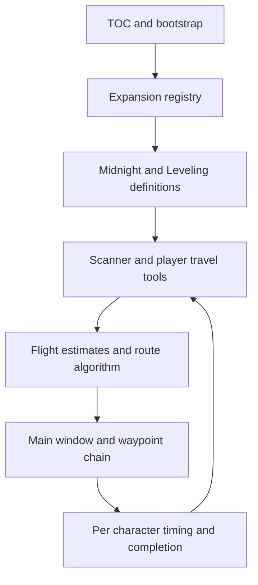
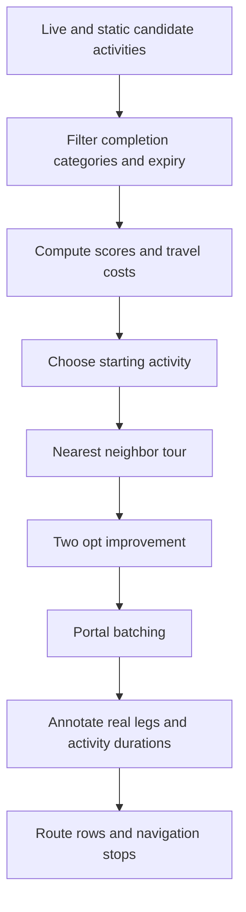

# Architecture and information flow

## Load order is a dependency contract

The TOC manifest is the program's load list. It first loads the bootstrap, then the expansion registry, then expansion zone/database/activity modules, then shared consumers, and finally the UI. A Lua file existing in the folder is not enough: if it is missing from the TOC it will not run. A file loaded before the namespace or data it requires can fail before the add-on reaches initialization.

`RS.Expansion:Register` stores an expansion's zones, level range, database and activity producers. `DetectActive` selects modules matching the character level, sorts their names deterministically and aliases `RS.DB` to a primary active database while carrying shared functions across. Zone-accessor facades preserve older call sites. This allows new content modules without duplicating the entire scanner, router or UI, but also means the primary alias and aggregated data must be checked when multiple modules match.

## Scanner and scoring contract

`RS.Scanner:GetActiveActivities` combines enabled world-quest scanning with static and dynamic activities from active expansion modules. `ScoreActivity` considers activity order, reward order, expiry and weekly-reset urgency. Settings profiles contain ordered lists of enabled activity and reward categories. Earlier enabled list entries receive stronger bonuses; disabling a category affects inclusion or weighting according to the scanner path.

World-quest data can come from task-quest and quest-log map APIs. Results are deduplicated by quest ID and filtered for completion, exclusion and near expiry. The source skips activities with less than twenty minutes remaining and marks activities under four hours as urgent. Those thresholds are implementation choices. Preserve the units in seconds when editing them; confusing API seconds with minutes produces errors that can look like a broken route optimizer.

The scanner publishes activities on `RS.activeActivities`; the wrapper builds `RS.currentRoute`. UI and navigation should consume that normalized result rather than independently asking the game for a different set of quests. A route stop normally wraps its activity in an `activity` field and adds travel, activity, arrival and departure seconds, urgency and portal notes. Synthetic portal stops can be inserted as navigation aids with zero activity duration.

## Routing costs and display estimates

`BuildCostMatrix` returns two matrices. The routing matrix includes preference bias; the display matrix preserves unmodified travel estimates. Preferred destination zones subtract 180 seconds down to a minimum cost of one; avoided destinations add 180. Nearest-neighbor also subtracts a score-derived credit, with a stronger cross-zone effect and an urgent-stop boost. These artificial credits should change ordering, not make the UI claim a physically shorter flight than the model predicts.

The 2-opt improvement is capped at fifty iterations. It evaluates route edges and reverses sections when estimated cost improves. Portal-zone batching follows. Because travel can be directed and the route is then annotated with actual leg calculations, future optimizer changes need tests that measure the final route, not only one local edge-swap formula. Do not promise a globally shortest route based on the name of a heuristic.

## Persistence and timing ownership

`RS_Settings` is account-level configuration. The TOC separately declares `RS_CharData` and `RS_DumpData` per character. `RS_CharData` contains manual completion, reset epoch and `activityTimes`. A timing record is `{ n, total, last }`, keyed by numeric world-quest ID or a stable string activity ID. `GetDuration` uses the rounded-up personal average first, a category default next, then `questTime *60` as fallback. Category defaults include five minutes for a world quest, twelve for a weekly, twenty for a weekly event and twenty-five for a dungeon.

`Timing:Record` ignores samples below fifteen seconds or above ninety minutes to avoid accidental clicks and AFK/disconnection outliers. Weekly reset clears manual weeklies and a choice cache, but intentionally retains personal timing. Reset detection uses the game's seconds-until-weekly-reset API and a five-minute skew allowance instead of a hardcoded regional maintenance hour. Preserve that distinction when adding migrations or data-clearing controls.

The bootstrap migrates older split world-quest timing into the unified table. Migration is code that changes old saved data into the current layout. Test it with copies of historical small fixtures before releasing a setting/schema change. Never use a real character's only SavedVariables file as the first migration test.
