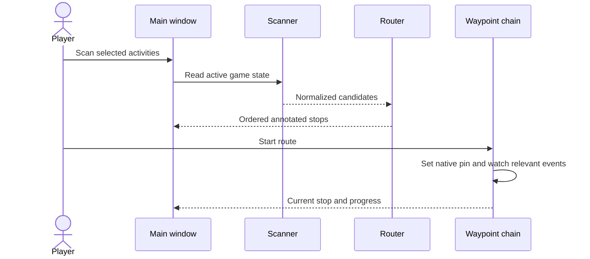

# Use routes profiles and navigation

## Build a route from current information

After login the bootstrap detects active expansions, initializes travel tools, stops a stale navigation chain and schedules a delayed scan. Open the appropriate world-map zones if quest information has not populated yet, then use `/rs scan`. The map callback is debounced because map changes can arrive rapidly. A temporarily incomplete scan is not automatically a math failure in the router.

Open the main window with `/rs` or the minimap control. Inspect activity names, zones, travel legs, estimated activity durations and cumulative time. Red urgency and travel color are presentation aids; they depend on model assumptions and current data. Verify that the character can actually do the listed activity before investing in a long trip. Level-based expansion activation can also explain why a route is empty for one character but not another.

## Select preferences deliberately

Use the settings/profile interface to create an editable custom profile rather than expecting the default profile to change. Activity order controls inclusion and priority, reward order controls scoring, and zone preferences influence travel choices. Prefer/avoid is a bias, not a hard prohibition. A First zone is handled by partitioning activities and routing its group before the remaining activities. In this source the First-zone branch concatenates stops without retaining the standard route total fields, and reads `last.mapID/x/y` although ordinary stops wrap coordinates under `last.activity`. That is a concrete source-level concern to reproduce before trusting this preference mode.

The flight model can be toggled with `/rs skyriding`; the source also attempts live aura/mount detection. Inspect which assumption changed when an estimate looks wrong. A ground-mounted or unmounted state can fall back to saved preference. Hearth/teleport availability is read through game APIs and saved ownership hints; an unknown API can trigger a fallback, so a suggested shortcut should still be checked by the player.

## Navigate and understand completion

`/rs nav` or `/rs start` begins the stop chain; `/rs stop` cancels it. Selecting a row can jump to a stop, while marking done removes or advances a candidate through the module's supported path. A quest stop with a quest ID does not auto-complete merely because the player stands near its coordinates. The waypoint code waits for appropriate quest events. Non-quest stops can advance after proximity dwell, and portal stops can advance after arriving at a portal or detecting the destination zone.

A visited location and a completed task are different facts. If a non-quest activity is still incomplete after a proximity-based advance, inspect its data classification and use the intended manual controls rather than silently trusting the navigation percentage. A completed week can require a turn-in quest rather than an accepted quest ID. The source uses dedicated turn-in IDs for some static tasks; preserve that semantic difference when adding IDs.

## Learn from personal timing

Completion/advancement can record a duration. The next route estimate can then use the character's own accumulated average. A single long AFK period should be rejected by the ninety-minute cap, but ordinary slow runs within that range still influence the average. Tooltips can show average, count and last sample. Review those values before blaming the flight model for a long total: travel and activity time are separate components.

`/rs resettime` clears all learned timing through the public slash handler. Although an internal `ResetOne` helper exists, the current handler does not expose arbitrary raw-key selection to the user. Do not document an internal function comment as a supported command. `/rs reset` clears manual weekly completion separately. Both are destructive to a specific data category, and neither is required just to close the window.

## Capture a useful problem report

Record source/client version, character level, active profile, selected flight mode, affected activity ID and the small observed symptom. A screenshot of a wrong route helps only when the expected origin, destination and relevant settings are known. `/rs dump` creates a wider character diagnostic snapshot in SavedVariables; examine and redact it locally before sharing any excerpt. It can contain quest, currency, faction, inventory and character details that do not belong in a public issue or handbook.

A good acceptance pass checks login, supported/unsupported level activation, map-data delay, a scan, profile change, a same-zone route, a portal transition, a quest turn-in, navigation stop, timing retention and normal logout. Repeat relevant checks after a client patch; a previously supported API name is not proof of unchanged current semantics.
