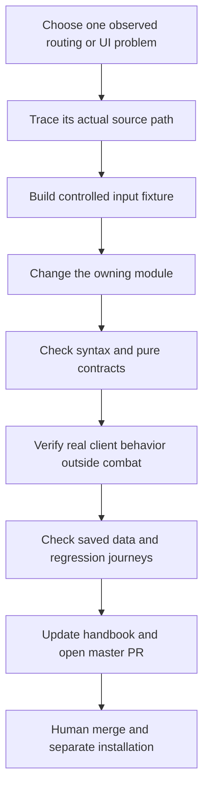

# Continue developing the add-on

## Add an activity without bypassing normalization

Start in the relevant `Expansions` module. Add a stable ID, display name, map ID, normalized coordinates, activity type, duration/reward data and an appropriate completion source. The map coordinates are fractions between zero and one, not percentages between zero and one hundred. Verify both the map identity and coordinates in the intended client. Adding an entry to a nonexistent older `Core/Zones.lua` path, as an old README passage suggests, will not update the currently loaded expansion data.

Trace the record through expansion aggregation, `GetActiveActivities`, `ScoreActivity`, `BuildRoute`, UI rendering and waypoint completion. Decide whether its activity type belongs in the profile-managed set or is a specialized leveling type. Add a fixture proving it is included when enabled, omitted when disabled/completed and not duplicated by overlapping API sources. For quest-based activities, test accepted versus completed versus turned-in states separately.

## Add an expansion module

Use the existing Midnight and Leveling module boundaries rather than copying the entire add-on. Supply the registry data, level range, zone definitions, connectivity, portals, database and activity producer, and add its TOC entries before shared consumers. Check `DetectActive` for overlap and deterministic primary-database choice. A valid registry record is only the beginning: merged zone IDs, hub assumptions, travel tools and profile classification must remain consistent.

Test an eligible and an ineligible level, no active expansion, two active modules, unknown zone width fallback, absent portal connectivity and delayed quest-line data. The Leveling implementation makes asynchronous requests for quest-line information. A request and a read in the same frame cannot be assumed to contain server-returned data. Design retries/events or prefetching explicitly and avoid loops that continually rescan every frame.

## Change route ranking with measurable fixtures

Create small synthetic activities in two or three zones and a controlled travel-cost function. Verify each candidate appears once, the first origin is correct, preference affects routing cost but not displayed physical time, urgent stops receive the intended bias, and the final annotated total equals the sum of legs and durations. Include a case with four or more stops so 2-opt actually runs, and a directed-portal case where reversing a segment changes internal edge directions.

Compare final route quality against a simple baseline before claiming an optimization. The heuristic is tuned for a modest candidate set. More candidates mean a pairwise matrix and repeated optimization passes can cost more client time. Measure scan time separately from routing and rendering; a slow map API is not evidence that the optimizer itself is slow.

## Evolve settings and saved data safely

The bootstrap fills missing defaults and migrates older timing records. A new field needs a default, a reader, a UI control if appropriate and a migration decision for existing profiles. Test an absent top-level SavedVariable, an old character record, a missing custom profile, an empty ordered list and a partially populated record. Preserve learned timing across weekly reset. Keep completion reset and timing reset distinct in both code and labels.

When adding a destructive control, name what it erases and require the intended user action. Do not add forced reload/checkpoint buttons as routine troubleshooting. The established usage requirement favors passive local diagnostics and preservation of current sessions. A targeted Lua reload during an isolated developer test is different from a product flow that repeatedly demands reloads to operate normally.

## Development evidence and publication

There is no implemented repository test framework that automatically proves all these conditions. Keep proposed checks labeled as checks to add until they exist and have been run. Preserve independent ownership of the source repository and the installed game copy. Do not silently synchronize or merge the other RouteSweet repository as part of a small feature, and do not overwrite saved variables or private diagnostic captures during a source update.
